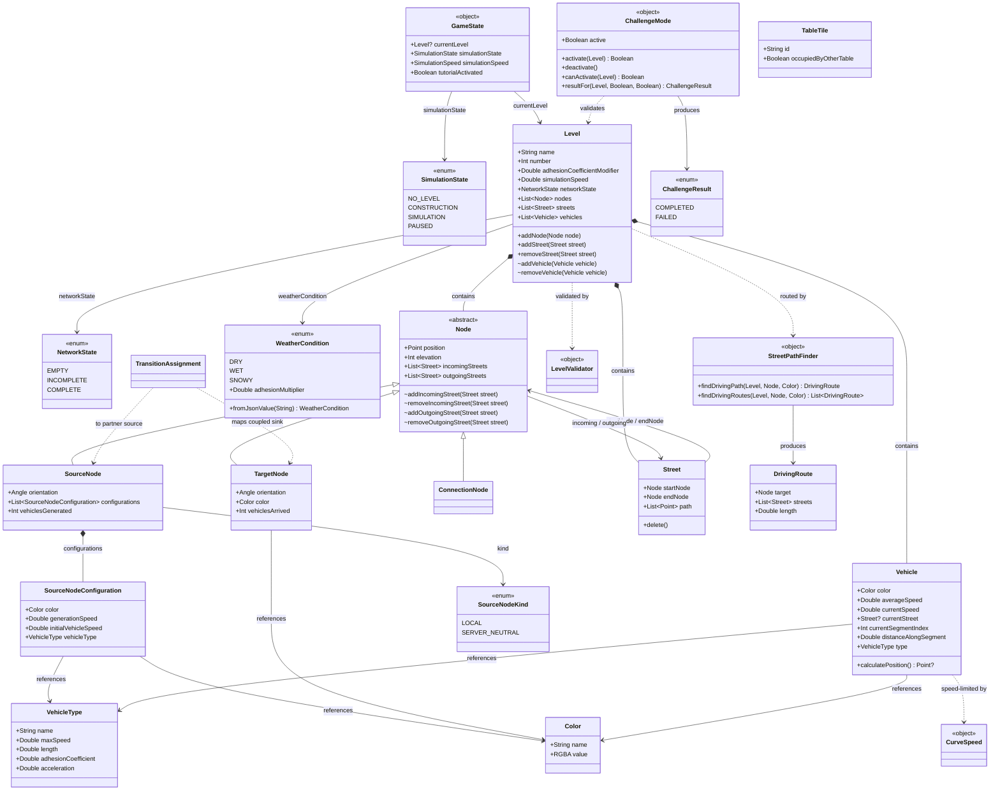
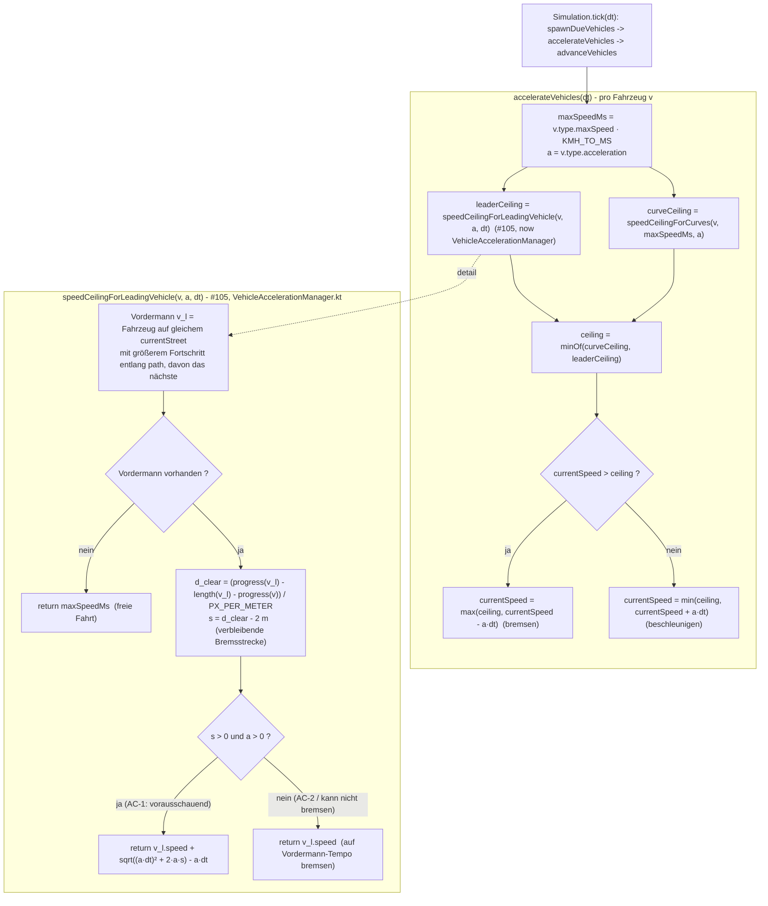

# AI Class Diagram

> **Last regenerated:** class diagram — **2026-07-08**, first AI-generated pass, triggered by the `[dev-merge-9]` deep content sync (developer request: "Tiefer Content Sync"). **Issue-level SDD:** the **#105** (Fahrzeugabstand & Kollisionsvermeidung) flow diagram below is now **historical** — see the status correction in its section header. Regeneration triggers: architecture-definition phase or issue-level SDD via the Mermaid skill. Each regeneration also appends to the **Change Log** section at the bottom of this file.
>
> **Cross-check performed (`[dev-merge-9]`, 2026-07-08):** compared against [`../spec/class_diagram.md`](../spec/class_diagram.md) (human-maintained) and `design.md`. **No divergence found** in the core domain model — every class/field/method in the human diagram (`GameState`, `SimulationState`, `NetworkState`, `Level`, `Node` hierarchy, `Street`, `SourceNodeConfiguration`, `Vehicle`, `VehicleType`, `Color`) still matches `src/domain/` as of `dev`/`main` @ `60e27e5`. The diagram below therefore **mirrors the human core exactly** and adds the Inkrement 3–5 domain-adjacent classes as explicitly-marked **AI extensions** (see the note after the diagram). Per [`Skills/AI-Dev-Process (Main-Skill)/REFERENCE.md`](Skills/AI-Dev-Process%20(Main-Skill)/REFERENCE.md) ("AI vs. human-maintained class diagrams"), only this file was written; `../spec/class_diagram.md` was read but not modified.

> **Purpose.** This file holds the **AI-maintained** Mermaid class diagram of the domain model — the diagram produced and updated by the `ai-dev-process` workflow (architecture-definition phase and issue-level SDD via the Mermaid skill).
>
> **Boundary vs. [`../spec/class_diagram.md`](../spec/class_diagram.md).** The diagram under `spec/` is **human-maintained** by the development team. This file (`AI-Dev-Process/ai_class_diagramm.md`) is the AI's counterpart and may be regenerated whenever the agent runs the architecture-definition phase or performs issue-level SDD. The two files are intentionally kept apart so the human source of truth is never silently overwritten.
>
> **When the two diverge.** If the AI's diagram and `spec/class_diagram.md` drift apart, raise the inconsistency (per [`REFERENCE.md`](Skills/AI-Dev-Process%20(Main-Skill)/REFERENCE.md) — "SDD and Mermaid guidance") before changing direction. The team decides whether the human diagram, the AI diagram, or `design.md` is the one that needs updating. **As of this pass, no divergence exists** — see the cross-check note above.

## Scope

- Captures the **current** domain-model snapshot as the AI understands it, derived from `src/domain/` and from `design.md`.
- Mirrors and **extends** [`../spec/class_diagram.md`](../spec/class_diagram.md). Extensions (classes not present in the human diagram) are grouped in a clearly-marked second block of the diagram below and listed explicitly afterwards.
- **Deliberately excludes** the service/infrastructure layers added in Inkrement 5 (`src/simulation/` managers, `src/network/`, `src/audio/`, `src/config/`, `src/geometry/`, `src/worldeditor/`) — those are architecture, not domain model, and are documented in [`design.md`](design.md) → "Main Components or Modules" instead. This mirrors the human diagram's own scope (it has never included `Simulation` either).
- Lives next to [`design.md`](design.md); changes to either should stay consistent.

## Class Diagram

**Extensions not in `../spec/class_diagram.md`** (all verified present in `src/domain/` as of `60e27e5`): `WeatherCondition` (Issue #160), `SourceNodeKind` (Issue #204/#207 area — distinguishes `LOCAL` vs. `SERVER_NEUTRAL` sources), `ChallengeMode` + `ChallengeResult` (Issue #108), `CurveSpeed` (Issue #91), `StreetPathFinder` + `DrivingRoute` (Issue #85), `LevelValidator` (the extracted §3.2 validation logic), `TableTile` (Issue #241, multi-table tile representation), `TransitionAssignment` (Issue #206, fixed sink→source coupling map). **Not shown**: `GameSimulationConfig` (a flat constants object with no associations — documented in `design.md` instead) and everything under `src/simulation/`, `src/network/`, `src/audio/`, `src/config/`, `src/geometry/`, `src/worldeditor/` (architecture/service layers, out of this file's domain-model scope — see `design.md`).

**For the team**: none of these extensions look human-diagram-worthy on their own merits (they're either single-purpose rule objects or small value types), but the PO/team may want to fold `WeatherCondition`, `ChallengeMode`, or `SourceNodeKind` into `../spec/class_diagram.md` if they're considered stable, load-bearing parts of the domain model going forward. No action taken here — this is a recommendation, not a change.

## Issue-level SDD

### #105 — Fahrzeugabstand und Kollisionsvermeidung

> ✅ **Status correction (`[dev-merge-9]`, 2026-07-08): this design IS implemented and released.** The ⚠ warning that used to sit here ("NOT implemented — removed during the `feat/92` merge") described the state as of `[dev-merge-3]` (2026-06-08), **before** Issue #105 was re-implemented and merged via **PR #137** (2026-06-08, released with the Inkrement-3 release PR #141). The flow below is now a historical **design record**, not a forward-looking plan. Since the Inkrement-5 restructure the actual code lives in `src/simulation/VehicleAccelerationManager.kt` (`speedCeilingForLeadingVehicle`) and `src/simulation/VehicleMovementManager.kt` (the hard movement clamp, there named `distanceAllowedByLeadingVehicle`) rather than directly on a monolithic `Simulation` class — the flow's *logic* still matches, only the file/class location has moved. Canonical constants: `GameSimulationConfig.MIN_DISTANCE_M = 2.0` (unchanged since PR #137), `LEADING_VEHICLE_LOOKAHEAD_M = 10.0` (⚠ changed from 20.0 during the Inkrement-5 congestion-hardening pass, Issue #153).

Issue-level SDD for the §3.3 minimum-distance / collision-avoidance rule (epic #8). This is a
**flow** view of the behaviour, not a class change: #105 added one private helper
(`speedCeilingForLeadingVehicle`) plus a constant (`MIN_DISTANCE_M = 2.0`)
and folds the helper's result into the existing speed ceiling via `minOf`.
No new domain class was introduced, so the class diagram above is unaffected by this section.

The design mirrors the existing curve-radius look-ahead (`speedCeilingForCurves`): the follower
brakes **predictively** so it can always brake down to the leader's speed before the clear gap
shrinks to 2 m. Because the leader is *moving*, the bound is the **relative**, discrete-safe
(Gipps-style) form `ceiling = v_leader + sqrt((a·dt)² + 2·a·s) − a·dt`, where `s = d_clear − 2 m`
is the distance still available. This holds the 2 m gap (acceptance criterion 1) even at coarse
tick sizes and prevents rear-end overlaps; the boundary case `s ≤ 0` collapses to `v_leader` —
braking to the leader's speed (acceptance criterion 2). Distances are clear (bumper-to-bumper):
the tracked vehicle position is treated as the front, and the leader occupies `length` metres
behind its own front — consistent with the existing arrival logic, where a vehicle's front
reaching the end node triggers the street transition.

**Scope note:** per the acceptance criteria, only the leading vehicle on the *same* street is
considered. Following a vehicle that has already crossed onto the next street, junction merges and
right-of-way are out of scope here and belong to #92.

## Change Log

- **2026-07-08 — `[dev-merge-9]` first class-diagram regeneration + #105 status correction.** Populated the "Class Diagram" section for the first time (previously always empty — "no AI-generated diagram yet"): mirrors `../spec/class_diagram.md`'s core exactly (cross-checked, no divergence) and adds 8 domain-adjacent extension classes (`WeatherCondition`, `SourceNodeKind`, `ChallengeMode`/`ChallengeResult`, `CurveSpeed`, `StreetPathFinder`/`DrivingRoute`, `LevelValidator`, `TableTile`, `TransitionAssignment`) grown across Inkremente 3–5, explicitly marked as extensions and listed in prose after the diagram. Also **corrected the stale #105 issue-level SDD status**: the section had carried a "NOT implemented" warning since `[dev-merge-3]` (2026-06-08), but Issue #105 was actually re-implemented and released via PR #137 that same day and has been live ever since (through the Inkrement-3, -4 and -5 releases) — the warning was never updated across five subsequent reconciliation passes. Replaced it with a status-correction note, updated the flow diagram's file references to the post-Inkrement-5 `src/simulation/VehicleAccelerationManager.kt`/`VehicleMovementManager.kt` locations, and flagged the `LEADING_VEHICLE_LOOKAHEAD_M` constant change (20.0 → 10.0) from the Inkrement-5 congestion-hardening pass. Deliberately excluded the Inkrement-5 service/infrastructure packages (`simulation` managers, `network`, `audio`, `config`, `geometry`, `worldeditor`) from the class diagram itself, consistent with this file's scope and with `../spec/class_diagram.md` never having modelled `Simulation` either — those are documented in `design.md`.
- **2026-06-08 — `[dev-merge-4]` sync note.** Since `[dev-merge-3]` `dev` gained **#104 Verkehrsaufkommen** (PR #131) and the `.exe` packaging tooling (PR #136). The `feat/105` branch's `7de280d` refined the #92 stop-line code. No AI **class** diagram had been generated yet at this point.
- **2026-06-08 — `[dev-merge-3]` status correction for the #105 SDD** (superseded by the `[dev-merge-9]` entry above, kept for history). The `speedCeilingForLeadingVehicle` / `MIN_DISTANCE_M` design was, at that point in time, implemented on `feat/105` and then removed when `feat/92` was merged in. Added a ⚠ status caveat — this caveat was correct when written but was never revisited after #105 shipped for real later the same day via PR #137.
- **2026-06-02 — issue-level SDD for #105** (Fahrzeugabstand und Kollisionsvermeidung). Added an
  "Issue-level SDD" section with a Mermaid **flowchart** of the acceleration sub-step: the new
  `speedCeilingForLeadingVehicle` ceiling folded into `accelerateVehicles` via `minOf`, the
  same-street leading-vehicle search, and the predictive discrete-safe braking bound
  `v_leader + sqrt((a·dt)² + 2·a·s) − a·dt`. No class added, so the (still empty) class-diagram
  section and `spec/class_diagram.md` were unaffected at the time — no divergence to reconcile.
- **2026-06-01 — `[dev-merge-2]` sync note.** The domain model had grown since the scaffold — notably `src/domain/CurveSpeed.kt` (Issue #91) and `Level.findNextStreetTowardTarget`.
