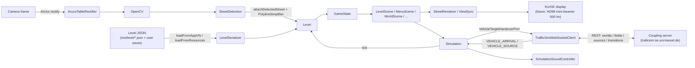

# Design

> **Last synced** with `dev`/`main` @ commit `60e27e5` on 2026-07-08 (`[dev-merge-9]`, deep content sync). Refresh on every `[dev-merge]` reconciliation pass — see [`WORKFLOW-LOG.md`](WORKFLOW-LOG.md). This pass replaces the previous header-only sync: the sections below now describe the **post-Inkrement-5 restructure** (`src/simulation/`, `src/network/`, `src/audio/`, `src/config/`, `src/geometry/`, `src/worldeditor/`), verified against the current `src/` tree and cross-checked against [`../spec/class_diagram.md`](../spec/class_diagram.md) for the domain-model core.

> Describes the **current reality** of the repository, mapped against the Lastenheft (`../spec/Lastenheft.pdf`), the **verified** GitHub-Issues / PR snapshot, and the **team wiki** at `https://github.com/sekassel/STP-2026-Team-D.wiki.git` (page `Gemeinsame-Grundlagen.md`) for branching, Definition of Done, and comment-style conventions. Not an idealised target architecture. Future-directed statements are labelled **Assumption** or **Recommendation**.
>
> **Branching reality** (per wiki convention): `main` and `dev` always exist; feature branches base on `dev` and merge into `dev`; `main` is updated by a `dev → main` release merge at the end of each Inkrement. As of this writing `main` (HEAD `60e27e5`) carries the **Inkrement-5** state, released via **PR #265 "Inkrement 5" (`dev → main`, merged 2026-07-06T21:50:52Z, git tag `Sprint5`)** — following Inkrement 4 (PR #202, 2026-06-22, tag `Inkrement-4`), Inkrement 3 (PR #141, 2026-06-08), Inkrement 2 (PR #100, 2026-05-25) and Inkrement 1 (PR #38, 2026-05-11). ⚠ The `Inkrement-5` git tag itself points at the **old** `e27c676` commit (identical to the `Inkrement-4` tag) rather than the real release commit `60e27e5` — a team tagging mistake, flagged in `devprocess.md`, not corrected here. The Inkrement-5 release brought the **entire multi-table server-coupling and world-management layer** to `main`: the new `src/network/` (REST + WebSocket clients, vehicle hand-over), `src/audio/` (driving/weather/horn sound), `src/config/` (centralised configuration), `src/geometry/` (polyline simplification), `src/worldeditor/` (world-editing session state) packages; the `src/domain/Simulation.kt` monolith split into the new `src/simulation/` package; ArUco-marker table rectification; and the full multi-table UI flow (`ServerMenuScene → WorldSelectionScene → WorldPlaceholderScene → WorldScene`). `dev` is at the same commit as `main` (a release merge does not advance `dev` itself) and has just opened the **Inkrement-6 "bug-free release" backlog** (`#266`–`#288`, 23 issues, almost entirely untriaged).

## Current Architecture

The application is a single-process JVM program built on the KorGE framework. Layered, top-down:

1. **Entry point** — [src/main.kt](../src/main.kt) bootstraps a 1800 × 1000 px KorGE window and shows `MenuScene`; [src/FullscreenToggle.kt](../src/FullscreenToggle.kt) (new in Inkrement 5) provides an AWT borderless-fullscreen toggle for the on-table kiosk mode.
2. **Scenes** (`src/scenes/`, 27 files) — menu/config scenes, the core `LevelScene` gameplay scene, and — new in Inkrement 5 — the full **multi-table flow** (`ServerMenuScene`, `WorldSelectionScene`, `WorldPlaceholderScene`, `WorldScene`, `WorldEditorScene`) plus supporting utility scenes. See "Scenes" below for the full breakdown.
3. **Rendering** (`src/rendering/`) — `StreetRenderer`, `ViewSync`, `LevelViewRenderer`, and **`GameAreaScale`** (the central coordinate/unit utility; unchanged in Inkrement 5).
4. **UI helpers** (`src/ui/`, 8 files) — `Assets`, `ControlButtons`, `VehiclePreview`, plus new-in-Inkrement-5 shared widgets `Scrollbar`/`ScrollbarInput`, `SceneUIUtils`, and the multi-table UI helpers `ServerMenuSceneUI`, `WorldPlaceholderSceneUI`.
5. **Domain** (`src/domain/`, 19 files) — the stable core model (`Level`, `Node` hierarchy, `Street`, `Vehicle`, `VehicleType`, `Color`, `GameState`) plus the rule/config objects that grew across Inkremente 3–5: `CurveSpeed`, `StreetPathFinder`, `LevelValidator`, `ChallengeMode`, `WeatherCondition`, `GameSimulationConfig` (the central physics/balance constants object, new in Inkrement 5), and — new in Inkrement 5 — `TableTile`, `ConnectionState`, `TransitionAssignment`, and a `kind: SourceNodeKind` field on `SourceNode`. **No longer here**: `Simulation` itself, extracted to its own package (see next point).
6. **Simulation** (`src/simulation/`, 13 files, **new package in Inkrement 5**) — the tick engine, extracted from the old monolithic `src/domain/Simulation.kt` into `Simulation` (orchestrator + constants) plus seven single-responsibility managers (`MergeManager`, `RouteManager`, `CongestionDetector`, `StatisticsCollector`, `VehicleSpawnManager`, `VehicleMovementManager`, `VehicleAccelerationManager`, `StreetUtilizationManager`) and shared utility objects (`RouteUtils`, `VehicleUtils`, `StreetUtils`, `SimulationUtils`). Still pure Kotlin, no KorGE imports — the NFR4 separability constraint is honoured through the split, not weakened by it.
7. **Network** (`src/network/`, 9 files, **new package in Inkrement 5**) — the multi-table server-coupling layer: REST client, WebSocket client, DTOs, the vehicle-hand-over adapters, and the connection-state singleton. See "Network" below.
8. **Audio** (`src/audio/`, 4 files, **new in Inkrement 5**) — driving-loop / weather-ambience / congestion-horn sound, hooked into the simulation tick from `LevelScene`.
9. **Config** (`src/config/`, 1 file, **new in Inkrement 5**) — `ConfigManager`, a centralised properties-file loader for camera, image-processing, simulation and network settings.
10. **Geometry** (`src/geometry/`, 1 file, **new in Inkrement 5**) — `PolylineSimplifier` (Ramer–Douglas–Peucker), used to smooth/cache detected street polylines.
11. **World Editor** (`src/worldeditor/`, ~11 files, **new in Inkrement 5**) — session/state management behind the world-editor scenes (`WorldEditorSession`, `WorldEditorRepository`, `EditorNodeRecord`, validation and placement helpers).
12. **Persistence** (`src/persistence/`) — `LevelSerializer` + `LevelDto` for JSON round-trips, `PredefinedLevelCatalog`, and — new in Inkrement 5 — `WorldTemplate` (blank multi-table world generator), `WorldLevelSelection`, `WorldMetadataStore`.
13. **Image processing** (`src/imageprocessing/`) — `StreetDetection` (OpenCV pipeline), `SkeletonPathfinder`, `CameraManager`, `StreetDetectionIntegration`, and — new in Inkrement 5 — **`ArucoTableRectifier`**, which now runs *before* `StreetDetection` in the pipeline.

The Lastenheft (§3.4 NFR4) explicitly requires that **image processing, domain model, simulation and projection be separable**. The Inkrement-5 restructure reinforces this: `Simulation` moved to its own package but stayed KorGE-free; the network/audio/config layers are additive side-channels (`VehicleTargetHandoverPort`, `SimulationSoundController.update(...)`) rather than entanglements of the tick loop itself.

`GameState` is a global `object` holding `currentLevel: Level?`, `simulationState`, `currentPredefinedLevelId: Int?`, `activeSimulation: simulation.Simulation?`, `simulationSpeed: SimulationSpeed`, and — new in Inkrement 5 — `tutorialActivated: Boolean`. The single-global-state design is a known, previously-flagged architectural risk for multi-table operation (see "Architectural Risks"); Inkrement 5 worked *around* it via the separate `ServerConnectionManager`/`ServerConnection` singleton rather than folding connection state into `GameState` itself.

## Technology Stack

Locked by Lastenheft §2 + verified against `build.gradle.kts`:

- **Language**: Kotlin (JVM target only; `targetJvm()` in `build.gradle.kts`).
- **Game framework**: KorGE (version pinned in `gradle/libs.versions.toml`).
- **Serialisation**: `kotlinx.serialization` (`plugin.serialization` 2.0.0; `serializationJson()`); Inkrement 5 also uses `kotlinx.serialization`-backed `JsonObject` for the WebSocket protocol.
- **Computer vision**: `org.bytedeco:javacv-platform:1.5.10` — JVM source set only; ArUco marker detection (Inkrement 5, `ArucoTableRectifier`) uses OpenCV's `aruco` module via the same dependency.
- **Networking** (Inkrement 5): a JDK `HttpClient` for REST calls (`TrafficSimRestClient`) and its async WebSocket API for the field-coupling channel (`TrafficSimWebSocketClient`), plus a custom `TrustedCertificates` SSL trust store.
- **Build**: Gradle 8.x via `gradlew`; JDK 21 (Zulu, per CI). Vendored sub-project `:deps`.
- **CI**: GitHub Actions on a **self-hosted runner** (moved from hosted, PR #190) — `gradle.yml` runs `./gradlew jvmTest`, `teamscale.yml` uploads JaCoCo coverage to `teamscale.se.uni-kassel.de`; `deploy-js.yml` exists but the JS Gradle target is commented out.
- **Project metadata**: KorGE `id = "com.sample.demo"`, root project `korge-hello-world` — template placeholders, still not customised.

## Folder and Package Structure

Top level:

- [README.md](../README.md), [LICENSE](../LICENSE), [.editorconfig](../.editorconfig), [.gitignore](../.gitignore)
- [build.gradle.kts](../build.gradle.kts), [settings.gradle.kts](../settings.gradle.kts), [gradle.properties](../gradle.properties), [gradle/](../gradle/), [gradlew](../gradlew), [gradlew.bat](../gradlew.bat)
- [korge](../korge), [korge.bat](../korge.bat), [kotlin-js-store/](../kotlin-js-store/), [deps/](../deps/), [deps.kproject.yml](../deps.kproject.yml)
- [src/](../src/), [test/](../test/), [res/](../res/), `config/` (new in Inkrement 5 — `app-config.properties`, read by `ConfigManager`)
- [spec/](../spec/) — pre-existing project artefacts: `Lastenheft.pdf` (canonical requirements) and `class_diagram.md` (human-maintained Mermaid class diagram, still an accurate description of the `src/domain/` **core** after the restructure — see "Domain model overview" below).
- [AI-Dev-Process/](.) — all `ai-dev-process` artefacts in one folder (see [`README.md`](README.md) for the full file-level breakdown; unchanged in this pass).
- [.github/workflows/](../.github/workflows/), [.run/](../.run/)

`src/` uses **flat top-level package directories** rather than `src/main/kotlin/<package>`. As of Inkrement 5 there are **12 packages** under `src/` (130 Kotlin files total): `domain` (19), `imageprocessing` (5), `persistence` (7), `rendering` (4), `scenes` (27), `ui` (8), `simulation` (13, **new**), `network` (9, **new**), `audio` (4, **new**), `config` (1, **new**), `geometry` (1, **new**), `worldeditor` (~11, **new**) — plus two root-level files (`main.kt`, `FullscreenToggle.kt`). Tests live in a sibling `test/` folder.

Resources:

- `res/level/` — pre-defined level JSON (`level1.json` … `level8.json`, plus `tutorial.json`).
- `res/savedlevel/` — user-saved networks.
- `res/images/` — UI graphics, vehicle icons, control icons, source/target markers.
- `res/road/` — sample road photographs for detection-pipeline testing.
- `res/fonts/` — fonts.
- `res/audio/` — **new in Inkrement 5**: driving-loop, weather-ambience and horn sound assets (`driving_car.wav`, `driving_truck.wav`, `driving_motorcycle.wav`, `weather_sunny_birds.wav`, `weather_rain.mp3`, `weather_winter_wind.mp3`, `traffic_horn.wav`), referenced by `SimulationSoundController`/`SimulationSoundTypes`.
- `config/app-config.properties` — **new in Inkrement 5**: optional overrides for camera, image-processing, simulation and network defaults; read by `ConfigManager`, falling back to built-in defaults when absent or invalid.

## Main Components or Modules

### Domain (`src/domain/`)

The **stable core** — `GameState`, `Level`, the `Node` hierarchy (`SourceNode`, `TargetNode`, `ConnectionNode`), `Street`, `Vehicle`, `VehicleType`, `Color`, `SourceNodeConfiguration` — is unchanged in shape since Inkrement 2 and still matches [`../spec/class_diagram.md`](../spec/class_diagram.md) (the human-maintained diagram); see "Domain model overview" below for the cross-check. Additions across Inkremente 3–5:

- **`CurveSpeed`** (Issue #91) — curve-radius physics (`r = abc/(4A)`, `V_max^i = min(V_max, √(μ·g·r))`).
- **`StreetPathFinder`** (Issue #85) — Dijkstra routing (`findDrivingPath`/`findDrivingRoutes` → `DrivingRoute`).
- **`ChallengeMode`** (Issue #108) — `object` with `activate`/`deactivate`/`canActivate`/`validationErrors`/`resultFor`; a challenge level may not exceed `challengeConnectionNodeLimit` connection nodes (default 4, `GameSimulationConfig.DEFAULT_CHALLENGE_CONNECTION_NODE_LIMIT`); result is `ChallengeResult.COMPLETED`/`FAILED`.
- **`WeatherCondition`** (Issue #160/#158) — enum `DRY`/`WET`/`SNOWY` with `adhesionMultiplier` (1.0 / 0.7 / 0.4) feeding the effective adhesion coefficient.
- **`LevelValidator`** — the §3.2 structural-consistency checks, now its own file (previously inline in `Level`).
- **`GameSimulationConfig`** (**new in Inkrement 5**) — `object` centralising every physics/balance constant previously scattered across `Simulation`'s companion object: unit conversion (`KMH_TO_MS`, `PX_PER_METER` ≡ `GameAreaScale.M_TO_PX_MULTIPLIER`), curve physics (`GRAVITY_MS2`), minimum distance / leader-following (`MIN_DISTANCE_M = 2.0`, `LEADING_VEHICLE_LOOKAHEAD_M = 10.0`, `LEADING_VEHICLE_BRAKE_MULTIPLIER = 5.0`), merge/right-of-way (`MERGE_CLEARANCE_M = 0.5`, `MERGE_STOP_LINE_EPSILON_M = 0.05`, `MERGE_WAITING_STOP_LINE_EXTRA_EPSILON_M = 0.01`, `STOP_LINE_FRONT_OFFSET_M = 3.0`, `MERGE_START_SPEED_KMH = 10.0`), congestion (`WAIT_TIMEOUT_S = 10.0`), route-switching (`ROUTE_SWITCH_CONGESTION_THRESHOLD = 0.5`, `ROUTE_SWITCH_LOAD_EPSILON = 0.0001`), utilization weighting (`UTILIZATION_DENSITY_WEIGHT`/`UTILIZATION_SPEED_WEIGHT = 0.5`/`0.5`), traffic-flow-rating thresholds (`TRAFFIC_FLOW_*`), simulation-speed multipliers (`SIMULATION_SPEED_X1/X2/X5/X10_MULTIPLIER`), roundabout detection (`MIN_ROUNDABOUT_JUNCTIONS = 3`, `ROUNDABOUT_RADIUS_TOLERANCE = 80.0`), and detection smoothing (`PATH_SIMPLIFICATION_EPSILON = 3.0`, `MAX_ROUTE_OPTIONS = 10`). **Some of these values changed during Inkrement 5's congestion-hardening work** (Issue #153): `STOP_LINE_FRONT_OFFSET_M` moved from 0.7 to 3.0 m, `MERGE_START_SPEED_KMH` from 7.0 to 10.0, `LEADING_VEHICLE_LOOKAHEAD_M` from 20.0 to 10.0 — a live-tuning trail worth keeping in mind when cross-referencing older PR descriptions in `devprocess.md`.
- **`TableTile`** (**new in Inkrement 5**) — `data class TableTile(id: String, occupiedByOtherTable: Boolean)`, the domain-facing view of one multi-table grid cell (backed by `ServerConnectionManager.tilesFor`).
- **`ConnectionState`** (**new in Inkrement 5**) — enum tracking the network connection lifecycle (mirrors/feeds `NetworkConnectionState` in `src/network/`).
- **`TransitionAssignment`** (**new in Inkrement 5**) — the fixed sink→source coupling assignment used by `FixedTransitionHandoverHandler` to route an incoming `VEHICLE_ARRIVAL` to the correct local source (Issue #206).
- **`SourceNode.kind: SourceNodeKind`** (**new in Inkrement 5**, `LOCAL` / `SERVER_NEUTRAL`) — distinguishes a player-placed source from a server-provided neutral source at a coupled table edge.
- **`GameState.tutorialActivated`** (**new in Inkrement 5**) — tracks whether the tutorial has run, decoupled from `currentPredefinedLevelId`.

### Simulation (`src/simulation/`) — new package, Inkrement 5

The tick engine, extracted from the old `src/domain/Simulation.kt`. `Simulation(level: Level, targetHandoverPort: VehicleTargetHandoverPort = NoVehicleTargetHandover)` still owns the constants (now largely delegating to `GameSimulationConfig`) and the top-level `tick(dt)` loop, but the actual work is split across seven managers, each instantiated per-`Simulation` and each single-responsibility:

- **`MergeManager`** — `updateMergeGrants()`: releases the current `mergeOccupant` at a merge node once it has cleared, then grants the next waiting approach in round-robin order (`mergeRightOfWay`) — the Issue #92 zipper-merge / right-of-way rule.
- **`VehicleSpawnManager`** — `spawnDueVehicles(dt)`: per-`(SourceNode, SourceNodeConfiguration)` spawn timers; also `injectHandoverVehicle(source, cfg, speedMetersPerSecond)`, the entry point the network layer uses to place an incoming coupled vehicle (Issue #209).
- **`VehicleAccelerationManager`** — combines three speed ceilings (curve look-ahead, merge yield, leading-vehicle) into the per-tick acceleration decision; applies the weather-adjusted adhesion budget.
- **`VehicleMovementManager`** — advances vehicles front-to-back per street, clamping movement by up to four constraints (merge stop line, same-street leader, merge proximity, cross-node leader), and — new in Inkrement 5 — calls `targetHandoverPort.handoverVehicle(vehicle, targetNode)` **before** removing an arrived vehicle at a coupled sink, so the network layer gets a chance to intercept it (Issue #208).
- **`RouteManager`** — `rerouteVehiclesAroundCongestion()`: switches a vehicle to a less-congested alternative route once the current one exceeds `ROUTE_SWITCH_CONGESTION_THRESHOLD` (built on the Issue #85 `StreetPathFinder`).
- **`CongestionDetector`** — the hardened Issue #153 congestion model: average-speed drop, merge-stop-line wait timeout (`WAIT_TIMEOUT_S`), and spawn-delay backup, any of which sets `Simulation.congestionDetected`.
- **`StatisticsCollector`** — accumulates the Issue #142/#143/#228 statistics (`SimulationStatistics`: generated/arrived counts, average speed, duration, road-network length, `TrafficFlowRating` ∈ `EFFICIENT`/`STABLE`/`OVERLOADED`, reworked in Inkrement 5 via #228).
- **`StreetUtilizationManager`** — the Issue #104 per-street `utilization ∈ [0,1]` (density factor + speed-deficit factor, `UTILIZATION_DENSITY_WEIGHT`/`UTILIZATION_SPEED_WEIGHT`).

Shared, stateless helpers live in `RouteUtils`, `VehicleUtils`, `StreetUtils` (and a `SimulationUtils` facade over the three). The **`VehicleTargetHandoverPort`** `fun interface` (`handoverVehicle(vehicle, targetNode): Boolean`) is the seam the multi-table network layer hooks into — `Simulation` itself has no `src/network/` dependency; `NoVehicleTargetHandover` is the no-op default for single-table play. This interface is the key architectural device that let Inkrement 5 add server coupling **without** touching the tick loop's control flow, honouring the pre-existing "domain has no KorGE imports" separability rule one layer further out.

### Network (`src/network/`) — new package, Inkrement 5

Implements Lastenheft's "multi-table coupling via a customer-provided server" (§2, §3.3, §5.1 Inkrement 5):

- **`NetworkDto.kt`** — the wire format: `WorldPropertiesDTO`/`CreateWorldDTO` (world metadata + creation), `WorldEditorStateDTO`/`WorldEditorNodeDTO` (editor round-trip), `QuelleNode`/`TransitionNode`/`FieldPropertiesDTO` (server-side source/transition/field model), and the WebSocket envelope `WebSocketMessage` with `WebSocketMessageType ∈ {FIELD_CONNECT, FIELD_DISCONNECT, QUELLE_ADDED, TRANSITION_ADDED, VEHICLE_DEPARTURE, VEHICLE_ARRIVAL, VEHICLE_SOURCE, ACKNOWLEDGMENT, ERROR}` and a `WebSocketErrorCode` enum.
- **`TrafficSimRestClient`** — REST client (world CRUD, editor-state CRUD, field/source/transition CRUD) against `ConfigManager.NetworkConfig.restBaseUri`.
- **`TrafficSimWebSocketClient`** — the persistent field-coupling channel: connects per field ID, sends `VEHICLE_DEPARTURE`, receives `VEHICLE_ARRIVAL`/`VEHICLE_SOURCE`, and runs a keepalive/heartbeat (10 s ping interval, 30 s silence-detection timeout) so a silently-dropped connection is still noticed (Issue #210 robustness).
- **`VehicleWebSocketConverter`** — `Vehicle ↔ JsonObject`, the agreed cross-team payload `{ color: {r,g,b,a}, type, speedMetersPerSecond }` (Issue #225 format, Issue #205 message definition); strict RGBA parsing so a malformed payload fails loudly rather than silently defaulting.
- **`CoupledSinkVehicleHandover`** implements `VehicleTargetHandoverPort`: on a vehicle reaching a bound coupled sink, converts it and sends `VEHICLE_DEPARTURE` via a `VehicleDepartureSender` (in practice, the WebSocket client) — Issue #208.
- **`FixedTransitionHandoverHandler`** — the inbound counterpart: pairs an incoming `VEHICLE_ARRIVAL` with the locally-mapped source via `TransitionAssignment` (Issue #206) and injects it through `VehicleSpawnManager.injectHandoverVehicle` — Issue #209.
- **`ServerConnectionManager`** / the `ServerConnection` singleton — the connection-state machine (`DISCONNECTED → CONNECTING → CONNECTED`, plus reconnect handling on loss, Issue #210) and per-world **tile claiming** (`tilesFor`, `claimTile`, `releaseTile`) that backs the `WorldPlaceholderScene` tile-selection flow (Issue #241).
- **`TrustedCertificates`** — the SSL trust-store setup for the `traficsim.se.uni-kassel.de` endpoint.

### Audio (`src/audio/`) — new package, Inkrement 5

Issue #226 ("Sound hinzufügen: Hupen bei Stau und Fahrgeräusche"), a §3.4-adjacent polish feature (audio is explicitly **excluded on the Raspberry Pi** per NFR5, so this is a laptop-mode enhancement):

- **`SimulationSoundController`** — loads/plays per-vehicle-type driving loops (`DrivingSoundType.CAR/TRUCK/MOTORCYCLE`) and per-weather ambience (`WeatherSoundType.SUNNY/RAIN/WINTER`, keyed off `WeatherCondition`), plus a congestion horn; `update(level, simulation, simulationState, elapsedSeconds)` is called once per frame from `LevelScene`.
- **`SimulationSoundPolicy`** — pure decision logic (`evaluate(SimulationSoundInput, elapsedSeconds): SimulationSoundDecision`): driving volume scales with moving-vehicle count/intensity, and the horn triggers on the *rising edge* of `congestionDetected` rather than continuously.
- **`SimulationSoundTypes`** — the sound-type enums plus `MovingVehicleSoundIntensities`, a small value type summarising per-type moving-vehicle intensity for the policy to consume.

### Config (`src/config/`) — new package, Inkrement 5

**`ConfigManager`** — Issue #42 ("Konfigurationsdatei für globale Konstanten") + the Inkrement-5 network settings. Reads `config/app-config.properties` and exposes four typed groups — `CameraConfig`, `ImageProcessingConfig`, `SimulationConfig`, `NetworkConfig` (host/port/active flag, deriving `restBaseUri`/`webSocketUri`) — each falling back to built-in defaults when the file is absent or a key is missing/invalid. `TrafficSimRestClient`/`TrafficSimWebSocketClient` both default their constructor to `ConfigManager.loadNetworkConfig()`.

### Geometry (`src/geometry/`) — new package, Inkrement 5

**`PolylineSimplifier.simplifyPath(points, epsilon)`** — Ramer–Douglas–Peucker polyline simplification, used to smooth/cache the jittery polylines that come out of camera-based street detection before they're stored as a `Street.path` (Issue #214).

### World Editor (`src/worldeditor/`) — new package, Inkrement 5

Session/state layer behind the `WorldEditorScene`/`WorldEditScene` UI (Issue #227): `WorldEditorSession` / `WorldEditorSessionFactory` (the active editing session and how it's constructed), `WorldEditorRepository` (save/load), `EditorNodeRecord` (mutable per-node editor state distinct from the immutable domain `Node`), `WorldEditorPlacement` (drag/place interaction), `WorldEditorDefaults`/`WorldEditorPalette`/`WorldEditorSessionPalette` (palette state and defaults for newly-placed nodes), `WorldEditorNodeSettings`/`WorldEditorConfigurationContext` (per-node property editing), `WorldEditorSourceConfigurations`, and `WorldEditorValidation`/`WorldEditorSessionValidation` (level-rule checking reusing `LevelValidator`).

### Persistence (`src/persistence/`)

`LevelSerializer` + `LevelDto`: pretty-printed JSON; name-keyed colour and vehicle-type tables; `LevelSerializationException` for malformed input; `weatherCondition` JSON key (Issue #160). New in Inkrement 5:

- **`WorldTemplate`** — `createBlankWorld(name)`: generates a blank multi-table world `Level` with a fixed border layout of source/target node pairs and no streets, as the starting point for the world editor (Issue #224).
- **`WorldLevelSelection`** / **`WorldMetadataStore`** — per-world selected-level metadata and a local cache of server world metadata, backing `WorldSelectionScene`.

**`PredefinedLevelCatalog`** is unchanged: Level 1–8 + `tutorial.json`.

### Image processing (`src/imageprocessing/`)

- **`ArucoTableRectifier`** (**new in Inkrement 5**, Issue #213) — detects the four corner ArUco markers (a 4×4/50 dictionary; one marker per corner) and perspective-rectifies the camera frame to a top-down `DESK_W_PX`×`DESK_H_PX` rectangle **before** the existing `StreetDetection` pipeline runs — replacing the earlier ad-hoc contour-based table crop and covering much of what used to be an untracked camera-calibration gap.
- `StreetDetection` — the existing OpenCV pipeline (BGR → HSV → red threshold → morphological closing → contour/skeleton extraction), now fed rectified frames.
- `SkeletonPathfinder`, `CameraManager`, `StreetDetectionIntegration` — unchanged in shape; `StreetDetectionIntegration` now also invokes `PolylineSimplifier` to smooth/cache the resulting polyline before folding it into the `Level` (Issue #214).

### Rendering (`src/rendering/`)

`StreetRenderer`, `ViewSync`, `LevelViewRenderer`, and `GameAreaScale` — **unchanged in Inkrement 5**. `GameAreaScale` remains the single source of truth for the three spatial domains (screen `1800 × 1000 px` ↔ virtual `225 × 125 m` ↔ physical `90 × 50 cm`, aspect ratio `9 : 5`); `Simulation`/`GameSimulationConfig`'s `PX_PER_METER` still derives from `GameAreaScale.M_TO_PX_MULTIPLIER`.

### UI (`src/ui/`)

`Assets`, `ControlButtons`, `VehiclePreview` — unchanged. New in Inkrement 5: `Scrollbar`/`ScrollbarInput` (a custom scrollbar widget, superseding ad-hoc per-scene scroll handling), `SceneUIUtils` (shared layout helpers), `ServerMenuSceneUI`, `WorldPlaceholderSceneUI` (rendering helpers for the two respective multi-table scenes).

### Scenes (`src/scenes/`, 27 files)

Pre-existing scenes (`MenuScene`, `LevelMenuScene`, `LevelScene`, `TutorialScene`, `ConfigurationScene` + its detail scenes, `SavedNetworksScene`, `NetworkSavedScene`) are unchanged in shape, modulo a new **`WeatherConfigurationScene`** (Issue #161) alongside the existing vehicle/source configuration scenes. New in Inkrement 5, the **multi-table flow**:

1. `MenuScene` → (globe entry point, Issue #219) → **`ServerMenuScene`** (+ `ServerMenuSceneLogic`) — server address + connect/disconnect, driving the `ServerConnectionManager` state machine, with a connecting/reconnecting overlay.
2. → **`WorldSelectionScene`** (+ `WorldSelectionActionPanel`, `WorldSelectionListRenderer`, `WorldSelectionSceneChrome`, `WorldSelectionServerLoader`) — lists predefined + server + local worlds; create (via `NewWorldCreationScene`/`NewWorldCreationServer`, Issue #223) / delete (Issue #231) / open.
3. → **`WorldPlaceholderScene`** (+ `WorldPlaceholderSceneLogic`) — the tile-grid claim/confirm step (Issue #241) before entering gameplay on a specific table.
4. → **`WorldScene`** — the multi-table wrapper around `LevelScene` for gameplay on a claimed tile, with **`WorldModeUi`** as the multi-table HUD overlay.
5. **`WorldEditorScene`** / **`WorldEditScene`** (+ `WorldEditSceneActions`, `WorldEditSceneUi`, `WorldEditorLayout`, `WorldEditorPalette`, `WorldEditorPropertiesPanel`, `WorldEditorSceneGeometry`, `WorldEditorStreetRenderer`) — the world editor itself (Issue #227), reachable from world selection/creation.

Cross-cutting new scenes: **`ConnectionLossNavigation`** (reconnect overlay on an unexpected drop, Issue #210), **`SceneBackground`**/**`SceneRecovery`** (shared background rendering + error-recovery scaffolding), **`MultiTableMenuScene`** (entry-point variant), **`PauseMenuShared`** (shared pause-menu logic factored out of `LevelScene`/`WorldScene`), **`ConfigurationDetailNavigation`** (routing helper for the configuration detail scenes).

### Domain model overview

Two Mermaid class diagrams live alongside this design:

- [`../spec/class_diagram.md`](../spec/class_diagram.md) — **human-maintained** diagram by the development team. **Cross-checked in this pass**: it still accurately describes the `src/domain/` **core** (`GameState`, `SimulationState`, `NetworkState`, `Level`, `Node`/`SourceNode`/`TargetNode`/`ConnectionNode`, `Street`, `SourceNodeConfiguration`, `Vehicle`, `VehicleType`, `Color`) — none of these classes' shapes have drifted from the diagram. It does **not** describe the Inkrement-3–5 domain additions (`CurveSpeed`, `StreetPathFinder`, `ChallengeMode`, `WeatherCondition`, `TableTile`, `SourceNode.kind`, `GameSimulationConfig`) or anything outside `src/domain/` (the new `simulation`/`network`/`audio`/`config`/`geometry`/`worldeditor` packages) — this is expected: it documents the **core** domain model by design, not the full architecture.
- [`ai_class_diagramm.md`](ai_class_diagramm.md) — **AI-maintained** counterpart, **populated in this pass** (`[dev-merge-9]`) with a class diagram that mirrors the human core and adds the domain-adjacent classes above as explicitly-marked extensions. Service/infrastructure classes (the `simulation`/`network`/`audio`/`config`/`worldeditor` packages) are described in this file's "Main Components" sections instead of in the class diagram, consistent with the AI file's own documented scope ("captures the current domain-model snapshot... derived from `src/domain/`").

## Data Flow

Sequence today (per `main.kt`, `Simulation` and, for multi-table sessions, `WorldScene`):

1. Load level JSON → `Level` (single-table), **or** claim a tile via `ServerMenuScene → WorldSelectionScene → WorldPlaceholderScene` and load the world's level (multi-table).
2. Camera frame → `ArucoTableRectifier` (perspective rectification) → `StreetDetection` → connection nodes + `Street` (via `PolylineSimplifier`-smoothed polylines) → `Level.addNode/addStreet`.
3. `GameState.currentLevel = level`; `simulationState = CONSTRUCTION`.
4. KorGE scenes render the level; `SimulationSoundController` starts weather ambience.
5. `Simulation.tick(dt)` while in `SIMULATION`: `MergeManager.updateMergeGrants()` → `VehicleSpawnManager.spawnDueVehicles()` (incl. handover injections from `FixedTransitionHandoverHandler`) → `VehicleAccelerationManager.accelerateVehicles()` → `VehicleMovementManager.advanceVehicles()` (calls `targetHandoverPort.handoverVehicle` at coupled sinks before removing arrived vehicles) → `StreetUtilizationManager.updateStreetUtilization()` → `CongestionDetector.checkForCongestion()` → `StatisticsCollector.recordStatisticsSample()`. `SimulationSoundController.update(...)` runs once per frame, reading `congestionDetected` for the horn and moving-vehicle intensities for the driving loop.

## Simulation Units and Constants

Canonical home: **`src/domain/GameSimulationConfig.kt`** (new in Inkrement 5 — supersedes the old scattered `Simulation`-companion-object constants; verified directly against the source, not inferred from PR descriptions):

- `PX_PER_METER = GameAreaScale.M_TO_PX_MULTIPLIER = 8.0` (1:250 scale, 20 px/cm). `GameAreaScale` itself is **unchanged**: `DESK_W_PX = 1800`, `DESK_H_PX = 1000`, `GAME_AREA_W_METER = 225.0`, `GAME_AREA_H_METER = 125.0`, `ASPECT_RATIO_W/H = 9.0/5.0`.
- `KMH_TO_MS = 1.0 / 3.6`; `GRAVITY_MS2 = 9.81` (§3.3 curve-speed physics, unchanged).
- Minimum distance / leader-following: `MIN_DISTANCE_M = 2.0` (unchanged), `LEADING_VEHICLE_LOOKAHEAD_M = 10.0` (⚠ **changed from 20.0**), `LEADING_VEHICLE_BRAKE_MULTIPLIER = 5.0` (unchanged).
- Merge / right-of-way: `MERGE_CLEARANCE_M = 0.5` (unchanged), `MERGE_STOP_LINE_EPSILON_M = 0.05` (unchanged), `MERGE_WAITING_STOP_LINE_EXTRA_EPSILON_M = 0.01` (**new**), `STOP_LINE_FRONT_OFFSET_M = 3.0` (⚠ **changed from 0.7**), `MERGE_START_SPEED_KMH = 10.0` (⚠ **changed from 7.0**), `STOPPED_SPEED_EPSILON_MS = 0.1` (unchanged).
- Congestion / route-switching (Issue #153 hardening): `WAIT_TIMEOUT_S = 10.0` (**new**, feeds `CongestionDetector`'s merge-stop-line-wait criterion), `ROUTE_SWITCH_CONGESTION_THRESHOLD = 0.5`, `ROUTE_SWITCH_LOAD_EPSILON = 0.0001` (both **new**, feed `RouteManager`).
- Utilization (Issue #104): `UTILIZATION_DENSITY_WEIGHT = 0.5`, `UTILIZATION_SPEED_WEIGHT = 0.5` (unchanged).
- Traffic-flow rating (Issue #142/#143/#228): `TRAFFIC_FLOW_OVERLOADED_MAX_UTILIZATION_THRESHOLD = 0.85`, `TRAFFIC_FLOW_OVERLOADED_AVERAGE_UTILIZATION_THRESHOLD = 0.70`, `TRAFFIC_FLOW_EFFICIENT_AVERAGE_UTILIZATION_THRESHOLD = 0.35`, `TRAFFIC_FLOW_OVERLOADED_AVERAGE_SPEED_KMH_THRESHOLD = 10.0`, `TRAFFIC_FLOW_EFFICIENT_AVERAGE_SPEED_KMH_THRESHOLD = 30.0`, `TRAFFIC_FLOW_EFFICIENT_ARRIVAL_RATIO_THRESHOLD = 0.90` (all **new**, feed `StatisticsCollector`).
- Simulation speed-up (Issue #144): `SIMULATION_SPEED_X1/X2/X5/X10_MULTIPLIER` (**new** — the previously ad-hoc speed factor is now a fixed enum-backed multiplier set).
- Detection smoothing / routing bounds (Issues #213/#214/#54): `MIN_ROUNDABOUT_JUNCTIONS = 3`, `ROUNDABOUT_RADIUS_TOLERANCE = 80.0`, `PATH_SIMPLIFICATION_EPSILON = 3.0` (feeds `PolylineSimplifier`), `MAX_ROUTE_OPTIONS = 10` (all **new**).
- Playback: `FIXED_PLAYBACK_STEP_SECONDS = 1.0/60.0`, `FIXED_STEP_EPSILON = 1e-12` (fixed-timestep tick, unchanged in intent from earlier Inkremente).

⚠ Several constants visibly changed during Inkrement 5's congestion-hardening pass (Issue #153, PRs #240/#246) — most notably the merge stop-line offset and restart speed. Treat any constant value quoted in an older `devprocess.md`/`WORKFLOW-LOG.md` entry (pre-`[dev-merge-9]`) as a historical snapshot, not current fact; this section is the canonical, source-verified current state.

## Status by Lastenheft Inkrement (§5.1) — verified

| # | Minimum requirement | Status | Verified evidence |
|---|---|---|---|
| 1 | Full domain model + persistence + load + visualise prepared level; straight-road detection; save networks; ≥1-vehicle real-time simulation. | **Done & released** | PR #38 "Inkrement 1" merged 2026-05-11. |
| 2 | Configurable source / vehicle properties; spawn per configuration; recognise + save full network (curves, crossings); multi-vehicle simulation without complex rules. | **Done & released to `main` via PR #100 (2026-05-25)** | See `devprocess.md` for the full closed-issue table. |
| 3 | All §3.3 simulation rules; modelling-error visualisation; simple result display; ad script. | **Done & released to `main` via PR #141 "Sprint 3" (2026-06-08)** | Full §3.3 rule set closed (curve-radius #91, right-of-way #92, 2 m distance #105, traffic volume #104, shortest path #85, Verstopfung #93). |
| 4 | Detailed statistics; configurable speed-up; table-only control; ad rough cut. | **Done & released** — PR #202 "Inkrement 4" (2026-06-22, tag `Inkrement-4`) | §5.1 core: statistics #142/#143, speed-up #144. |
| 5 | Multi-table server coupling; final ad. | **Done & released** — **PR #265 "Inkrement 5" (`dev → main`, merged 2026-07-06T21:50:52Z, `main` HEAD `60e27e5`, tag `Sprint5`; ⚠ `Inkrement-5` tag mistagged — see header)** | Full minimum set closed: server interaction/config **#203/#204**, transfer & coupling **#205–#210/#212**, worlds **#221/#222/#223/#224/#227/#230/#231/#241**, multi-table UI **#211/#219/#232**, ArUco **#213**, smoothing **#214**, sound **#226**, statistics rework **#228**, data format **#225**; video finalisation **#215–#218** completes the full §4 line (#101→#145+#148→#215→#216→#217→#218). Carried-over **#99/#182/#248/#249** closed too. Only **#229** (Teamscale) survived. Still untracked even after release: deterministic simulation (NFR7), full table-only control. |
| 6 | Bug-free final release. | **Started** | 23-issue backlog **#266–#288** opened 2026-07-07/08, almost entirely untriaged; see `devprocess.md` for the full table. |

The remaining cross-Inkrement gaps are **deterministic simulation (NFR7)** and **full table-only control** — both still without a tracking issue as of this pass.

## External Dependencies

- **KorGE** (game framework).
- **kotlinx.serialization** (level JSON + WebSocket `JsonObject` payloads).
- **JavaCV / OpenCV** (`org.bytedeco:javacv-platform:1.5.10`) — JVM-only; now also used for ArUco marker detection.
- **JDK `HttpClient`** (REST + WebSocket, Inkrement 5) — no external HTTP library dependency.
- **Vendored `:deps` project** — exports artefacts to `commonMainApi`.
- **JDK 21 / Zulu** (per CI).
- **Coupling server** (`traficsim.se.uni-kassel.de`) — external, team-provided; not part of this repository.

## Test Strategy

- **Unit / domain tests** under `test/`, organised into subject subfolders. New in Inkrement 5 (folder names not independently re-verified against the full test tree in this pass; cross-check before relying on exact paths): simulation-manager-level tests alongside the existing `test/domaintests/`, plus network tests exercising `TrafficSimWebSocketClient`/`ServerConnectionManager` against a real or mocked server connection (the earlier `ServerConnectionMock` was replaced by exercising `ServerConnection` directly per the Teamscale-findings cleanup, PR #236 era).
- **CI gate**: `./gradlew jvmTest` on push to `main`/`dev` (self-hosted runner, PR #190); Teamscale coverage upload (`teamscale.yml`).
- **Gaps** (unchanged from earlier passes):
  - No end-to-end smoke test covering `main.kt`.
  - No determinism test (Lastenheft NFR7).
  - No performance test (Lastenheft NFR6: 60 FPS @ 1000 vehicles on RPi 5B 2 GB) — now more pressing given Issue **#276** ("Raspberry Pi Performance Anforderungen erfüllen") in the new Inkrement-6 backlog.
  - No coverage report beyond the Teamscale dashboard.

## Known Design Issues

- ~~**Monolithic `Simulation.kt`.**~~ Resolved by the Inkrement-5 restructure: split into `Simulation` (orchestrator) + 7 managers + shared utility objects under `src/simulation/`. No dedicated issue; a by-product of the multi-table coupling work.
- ~~**No multi-table hand-over seam.**~~ Resolved via `VehicleTargetHandoverPort` (Issue #208/#209) — `Simulation` gained one optional constructor dependency rather than a network dependency.
- ~~**Global `GameState` incompatible with multi-table.**~~ Partially addressed: connection/tile state was kept **out** of `GameState` entirely, in the separate `ServerConnectionManager`/`ServerConnection` singleton. `GameState` itself is still a single global `object`; this works for the current one-simulation-per-process model but would need revisiting if a single process ever ran multiple concurrent tables.
- **Second connection-state enum.** `src/domain/ConnectionState` and `src/network/NetworkConnectionState` appear to track overlapping lifecycles (`DISCONNECTED`/`CONNECTING`/`CONNECTED`/…) in two different packages. Not confirmed whether one delegates to the other or they're independently maintained — worth a closer look before extending either.
- **Determinism not enforced** (no seeded RNG, map iteration order unpinned). No tracking issue.
- **`deploy-js.yml`** workflow targets a JS build that is disabled in `build.gradle.kts`.
- **KorGE template defaults.** `id = "com.sample.demo"`, `rootProject.name = "korge-hello-world"`.
- **`:deps` opacity.** Vendored sub-project's transitive exports not documented here.
- **Mixed-language documentation.** Unchanged from earlier passes — Lastenheft + README + GitHub issues in German; KDoc + process artefacts in English.

## Architectural Risks

- **Hardware integration — closed out.** Live-camera ingestion, camera integration, camera→detection wiring, ArUco-marker rectification (#213) and detection caching/smoothing (#214) are all closed and released. The one open detection item (Issue #182) is now also closed (PR #262). New Inkrement-6 items (**#268** fehlerhafte Kameraerkennung bei Verstopfung, **#283** Brückenerkennung verbessern, **#285** Erkennung schneller und robuster) suggest detection robustness is not permanently settled — expect this risk to resurface.
- **JavaCV ARM64 natives.** Still unverified; now also relevant to ArUco detection, not just the original street-detection pipeline.
- **Performance budget.** 1000 vehicles × 60 FPS on a 2 GB ARM SBC is tight and now **explicitly tracked** as Inkrement-6 Issue **#276**. The manager-split in `src/simulation/` adds call-boundary overhead per tick relative to the old monolith; not measured.
- **Determinism vs. parallelism.** Camera loop + simulation tick + WebSocket I/O + audio now genuinely run across multiple threads/coroutines (the network client is async; `SimulationSoundController` uses a `CoroutineContext`). NFR7 (determinism) has **not** been designed for this — the risk is now more concrete than "once camera loop + simulation tick run on separate threads."
- **Single global `GameState`.** See "Known Design Issues" above — worked around for connection state, not resolved architecturally.
- **Network robustness.** The heartbeat/reconnect logic in `TrafficSimWebSocketClient`/`ServerConnectionManager` (Issue #210) is new and only as battle-tested as the Inkrement-5 acceptance testing covered; a coupling-server outage or flaky network mid-Inkrement-6-demo is a plausible failure mode worth explicitly rehearsing.
- **Hidden coupling via `:deps`.** Unclear which transitive APIs are exposed via `commonMainApi`.
- **JVM-only target.** Locking to JVM is deliberate; revisiting later would require touching every KorGE target line.

## Intended Architecture Direction

**Recommendations**, not commitments — to be confirmed via `grill-me` during the `architecture-definition` phase and ratified by the PO before becoming canonical.

- ~~Move global `GameState` toward an injected `SessionState` per simulation run before server coupling (Inkrement 5).~~ **Partially done differently**: connection/tile state moved to `ServerConnectionManager`, but `GameState` itself remains global. Revisit if concurrent multi-table sessions in one process ever become a requirement (not currently one).
- **Reconcile the two connection-state enums** (`domain.ConnectionState` vs. `network.NetworkConnectionState`) — pick one as canonical or document the mapping explicitly.
- **Add the deterministic-clock + seeded-RNG layer (NFR7)** — now more urgent given genuine multi-threaded I/O (network, audio) alongside the simulation tick.
- **Performance-test the Inkrement-5 manager split** on representative hardware (RPi 5B 2 GB) — directly serves the new Issue #276.
- Introduce a **camera-input adapter port** — largely superseded by `ArucoTableRectifier` + the existing `CameraManager`; revisit only if a second detection backend is ever needed.
- Reconcile `deploy-js.yml`; customise the KorGE `id` and `rootProject.name`.
- Apply the wiki comment-style convention (KDoc doc-strings only, no `//` line comments) on a pass through the newer `network`/`simulation`/`worldeditor` packages — not verified in this pass.
- When the agent next runs the architecture-definition phase or any issue-level SDD, keep [`ai_class_diagramm.md`](ai_class_diagramm.md) (populated in this pass) consistent with `../spec/class_diagram.md` per the rule in [`Skills/AI-Dev-Process (Main-Skill)/REFERENCE.md`](Skills/AI-Dev-Process%20(Main-Skill)/REFERENCE.md) (AI vs. human-maintained class diagrams).
